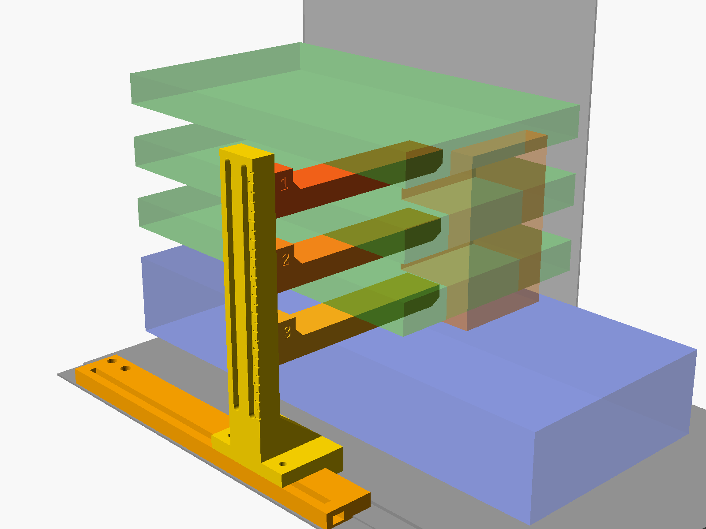

# V3000 PLUS triple-GPU floor support

A 3D-printed support for three water-blocked GPUs in a Lian Li V3000 PLUS (Standard layout, cards in slots 1/3/5). It stands on the floor of the main compartment instead of screwing into the motherboard, so it leaves room for a thick air-cooled card in the bottom slot (slot 7). That card isn't supported.

The post sits outboard of all the cards on the glass side, and a finger reaches in under each block, halfway to the motherboard. Each finger adjusts along long slots in the post. The rail screws down through the vent/rad plate's existing flange holes, so no new holes are needed.

*Green: the three supported cards. Blue: the unsupported lower card. Translucent orange: assumed terminal keep-out.*

## Files

| File | What |
|---|---|
| `gpu_support.scad` | Parametric OpenSCAD source. Everything is in case coordinates taken from Lian Li's STEP. |
| `stl/rail.stl`, `stl/column.stl`, `stl/finger1-3.stl` | Print-ready, already oriented. |
| `stl/plate.stl` | All five parts on one 235 × 223 mm plate (44 mm tall). |
| `step/*.step` | The same parts as STEP (from the mesh). |
| `renders/*.png` | Iso, front, top and print-plate views. The case floor and GPUs are simple stand-in boxes. |
| `build.sh` | Re-exports STLs, renders and STEP files. It also re-runs the fit check if you've imported the case model (see below). |
| `scripts/` | FreeCAD scripts: STEP export, case import and the interference check. |

The case dimensions in `gpu_support.scad` were measured from Lian Li's published V3000 PLUS STEP model. That model is Lian Li's and **is not included here**.

### Re-running the fit check against the real case

1. Download the V3000 PLUS 3D model from [lian-li.com](https://lian-li.com/product/v3000-plus/) and extract it to `lianli/20230207_V3000 PLUS_3D/`. The `lianli/` folder is git-ignored.
2. Import it once (takes about a minute):
   `GPU_SUPPORT_REPO=$PWD freecadcmd -c "exec(open('scripts/import_case.py').read())"`
3. Run `./build.sh`. It writes `lianli/fit_check.txt` and `lianli/V3000_with_gpu_support.FCStd`, which contains the case with the support and GPU envelopes in place.

The tool paths default to Windows installs of OpenSCAD and FreeCAD 1.1. Override them with the `OPENSCAD` and `FREECADCMD` environment variables.

## Measure these before printing

Set the values at the top of `gpu_support.scad`, then run `./build.sh`.

| Parameter | Default | How to measure |
|---|---|---|
| `block_drop` | 13.5 | Distance from the PCB/PCIe edge connector down to the bottom face of the block. |
| `pcb_offset` | 6.0 | **Estimated** from the PCIe CEM envelope, not measured. Check: the slot-1 card's PCB should sit about 6 mm above the centre of the case's top slot opening. The long slots let every finger move far enough to absorb any error. |
| `col_z` | -120 | Post position front/back, measured from the bracket outer face. -120 is **186 mm** from the bracket face and 54 mm behind a 240 mm block's far end. Move it so the fingers clear the terminal and the 12VHPWR cables. The rail allows anywhere from **128** mm (where the rear glass hinge is) to 221 mm from the bracket face. |
| `finger_reach` | 0.5 | Fraction of the way from the card's outer edge to the motherboard. 0.5 puts the tip at X 8.5, about 72 mm under each block. |
| `h_gpu` | 140 | Supported card height including the block. This decides where "halfway" is. |
| `len_gpu`, `len_low`, `h_low` | 240, 330, 140 | Supported card length; lower card length and height. Used only for the clearance check. |

## Clearances (FreeCAD check against the real case STEP)

- Finger top to block bottom: 2.0 mm, which the pad fills.
- Finger bottom to the next card's backplate: about 7.3 mm (each gap is about 21.3 mm, the arm is 12 mm thick).
- Support to the lower card's envelope: at least 7.3 mm.
- Post to glass: 7.5 mm (about 5 mm with button-head bolts).
- Overlaps with the case: none, except the two stock M3 vent-plate screws, which get replaced (below).
- Finger travel along the slots: about 10 mm up and 45 mm or more down from the nominal height, for every finger.

## Hardware

| Qty | Part | Use |
|---|---|---|
| 2 or more | M3 × 12, same thread type as the stock screw | Replaces the **first two vent-plate screws from the rear** on the glass-side flange (about 43 mm and 196 mm from the rear end of the floor). |
| 2 | M4 × 16 socket head + 2 M4 hex nuts | Post foot to rail (the nuts slide into the rail channel from either end). |
| 6 | M4 × 30 button head + 6 M4 hex nuts | Fingers to post (14 mm post + 12 mm finger root). The nuts drop into the pockets on the fingers. They're a slip fit (7.45 mm across flats), so hold them in with a finger or a scrap of tape while you start the bolt. |
| 3 | 2 mm silicone/rubber pad, about 26 × 20 mm | Stuck on each finger top, out near the tip. |

## Printing (PETG)

- 0.2 mm layers, 5 walls, 5 top/bottom layers, 40 % gyroid infill. No supports.
- **Keep the exported orientations:**
  - The **post** stands on its glass-side face, so the long slots print as vertical openings with nothing to bridge.
  - The **fingers** print on their side.
  - The **rail** prints upside down, with its flat top on the bed.
  - In each case the bending loads run along the layers rather than trying to split them.
- About 180 g of filament in total.

## Install

1. Remove the glass. On the glass-side flange of the vent plate, remove the first two M3 screws from the rear.
2. Slide two M4 nuts into the rail channel. Place the rail along the glass. It has a counterbored M3 hole over **every** hole on that flange: five holes at about 28, 43, 196, 206 and 215 mm from the rear end of the floor. The two with raised collars sit in clearance pockets underneath. Screw through the two stock-screw holes (43 and 196 mm). Add screws in any other hole that has a thread under it in your case configuration.
3. Press the M4 nuts into the finger pockets. Rest each finger in its gap with the arm under its block and the root outside the card.
4. Lower the post onto the rail, with the toe dropping beside the rail edge onto the mesh. Slide it to position and tighten the two foot bolts. They sit in front of and behind the post, so you can reach them from above.
5. Bolt each finger through the slots from the glass side. Lift it until the pad just touches the block and the card is level (check with a level on the far end), then tighten. Don't lift the card above level. The ticks on the glass-side face of the post are every 5 mm, with a long tick every 10 mm.
6. Check that no 12VHPWR cable or terminal fitting is pressed by the post or fingers. If one is, slide the post along the rail.

Longer fingers mean more leverage, so the rail screws take more pull. With a realistic load (about 10 N per card) that's well within what two M3 screws and the toe can hold. Still, tighten the rail screws fully before loading the fingers.

## License

[MIT](LICENSE). Lian Li and V3000 PLUS are trademarks of Lian Li Industrial Co., Ltd., used here only to say which case this fits. This project is not affiliated with or endorsed by Lian Li.
